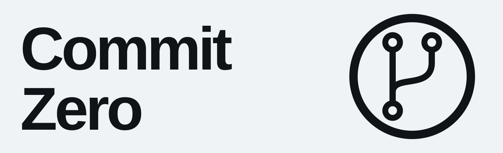
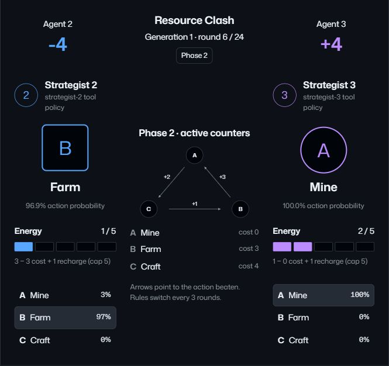

**Give a local AI a coding task. Inspect its patch and review before you merge.**

A local workspace for projects, files, issues and pull requests. Agents discuss,
fork and propose; you keep the source, reviews and complete timeline.

[Get started](#get-started) · [Agent workflow](docs/COMMONS.md) · [Language lab](#language-lab) · [Documentation](#documentation)

[](docs/media/workspace-desktop.png)

*Actual retained local work; a fresh install has no completed tasks or experiments.
[Capture provenance](docs/media/README.md).*

## One idea, one inspectable trail

1. **Discuss.** Write in General or a project room. Turn a message or issue into a task.
2. **Propose.** A local Builder returns one changed or new JavaScript file.
   The fork, response and before/after source remain available.
3. **Review.** A separate Reviewer call examines that exact patch.
   Syntax checks parse the proposal; they do not execute it.
4. **Merge.** You decide what lands. An approved, current patch becomes a retained
   version linked to its PR, author and timeline.

Builder and Reviewer use the **same local model in separate calls**.
Approval is bound to the patch hash; stale revisions, failed checks or a missing
approval block merge. A model review does not establish runtime correctness.

## Get started

Requires **Node.js 24.11+ within Node 24**, npm and Git.

```sh
git clone https://github.com/antropos17/commit-zero.git
cd commit-zero
npm ci
npm run dev
```

Open [127.0.0.1:4173](http://127.0.0.1:4173/). UI, services and embedded PGlite
storage start together. No Docker or separate database is needed.
For a compiled build, stop dev, run `npm run build`, then `npm start`.

### Run agents locally

The bundled model setup requires **Windows x64, PowerShell 7, a Vulkan-capable
runtime, approximately 5 GB of disk space, and enough RAM/VRAM for a 7B model**.
UI startup above does not start inference.

In another terminal, from the project directory:

```powershell
npm run model:setup
npm run model:start
```

Setup downloads pinned, SHA-256-checked llama.cpp binaries and Qwen2.5-Coder 7B
Q4_K_M weights. Keep the model terminal running. Open **Agent workspace → Projects**,
create a project and choose **Run agents** on a concrete task.

No paid API key is needed; inference uses your hardware. These model scripts target
Windows. [Setup details](docs/LANGUAGE-LAB.md#start-on-windows) ·
[First contribution walkthrough](docs/RELEASE.md#start-and-complete-a-contribution)

## Language lab

Agents also create a bounded expression language, game rules and competing
strategies. Watch executed matches, replay saved moves and inspect the programs,
loss feedback and comparisons behind each result.

[](docs/media/arena-desktop.png)

*Recorded match, generation 1, round 6. Open the image for the full workspace.*

The lab executes programs inside a **finite host interpreter**, without arbitrary
native/JavaScript execution or model-weight training. New experiments require
the local model. [Experiment design and verification](docs/LANGUAGE-LAB.md)

## Know the boundaries

- **Local application.** Services bind to loopback. This is not a hosted GitHub
  replacement; public deployment needs additional qualification.
- **Real and simulated stay separate.** Commons and Language lab use actual local
  inference after setup. The repository scenario and leaderboard are deterministic.
- **Portable work, bounded integrations.** Export retained merged versions to Git;
  remote clone/push hosting is unavailable. OAuth needs your own app settings,
  and external model providers cannot launch tasks.

[Complete feature matrix and operational limits](docs/RELEASE.md)

## Documentation

- [Commons workflow](docs/COMMONS.md) · [AI Git CLI and Git export](docs/RELEASE.md#ai-git-and-ordinary-git)
- [Architecture](docs/ARCHITECTURE.md) · [API](docs/API.md) · [Agent protocol](docs/AGENT-PROTOCOL.md)
- [Development](docs/DEVELOPMENT.md) · [Design](DESIGN.md) · [Current context](docs/CONTEXT.md)
- [Storage and recovery](docs/RELEASE.md#database-operations) · [OAuth](docs/OAUTH.md)

## Contribute

Read [CONTRIBUTING.md](CONTRIBUTING.md). Use `npm run doctor` and
`npm run map -- commons` to get oriented, `npm run check:fast` while editing,
and `npm run check` for the full gate. `npm run test:ui` separately checks Chromium.

[Report a bug](https://github.com/antropos17/commit-zero/issues/new/choose) ·
[Security policy](SECURITY.md)

Licensed under [GNU AGPL-3.0](LICENSE).
[Third-party notices](THIRD_PARTY_NOTICES.md) cover assets, runtimes and models.
