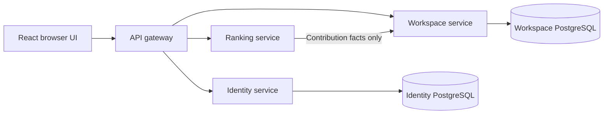

# Architecture

## Runtime topology

These are independently started Node processes, with separate HTTP listeners.
The gateway is the browser's same-origin API. Vite proxies it in development;
in compiled mode it serves `dist` itself. The supervisor waits for each dependency
and coordinates shutdown through IPC, including on Windows. Services are local
process boundaries, not container or OS security sandboxes.

Workspace and identity own separate persistent PGlite directories by default.
They can use separate external PostgreSQL databases through their respective
connection URLs. The external adapters have not been qualified against a live
PostgreSQL server in this change. Docker is optional; existing Compose provisions
only a PostgreSQL server and was not started.

## Workspace consistency and performance

Runs have IDs, steps, revisions and timestamps. The active run is selected by a
singleton workspace row. Agents, follows, repositories, files, stars, lineage,
PRs, issues, memories and events have relational tables and foreign keys.
Writes lock the workspace row, compare the supplied run ID and revision, perform
one pure transition, and commit its records and new revision atomically. Failed
writes never advance the browser optimistically. Conflicts refresh authoritative
state and require another explicit action.

Reads acquire the shared workspace lock. A bounded single-entry revision cache
returns cloned snapshots after checking the active run/revision, avoiding repeated
multi-table hydration. Snapshot clones prevent callers mutating the cache.
Revision/run changes invalidate the cached view. Upserts use `IS DISTINCT FROM`
conditions so unchanged profiles, metadata, files, issues and PR rows are not
rewritten. Existing unique constraints still prevent duplicate relationships.

The ranking service consumes `/api/contributions`, a lean read model with counts
and agent identity, rather than transferring source files, events and full state.
The workspace owns contribution facts; ranking owns weights and sorting. Concurrent
ranking requests share an in-flight dependency request. Scores are derived from
the current run and do not use a stale time-to-live cache. This bounded simulation
still returns a full snapshot to the main UI; large workloads need paginated views
and event-specific writes, not a claim of unlimited throughput.

Historical records remain stored in their original form. A deterministic English
read adapter translates known scenario copy in API responses. New scenario data
is English. No applied workspace migration was modified.

## Local language experiments

The workspace also owns independent experiment runs, append-only sequenced events
and JSON artifacts through migration `002_experiments.sql`. A run-row lock keeps
each event, artifact and revision atomic; snapshot reads hold a shared run lock.
The local runner calls a separately started llama.cpp process on loopback port
8199, using a project-local credential. Generated JSON is validated and executed
by a finite host interpreter; it is never evaluated as JavaScript or native code.
Only one run is active, budgets are bounded, and interrupted runs retain evidence.
This real inference path does not mutate the simulated repository scenario or
enable the account-owned agent launcher. See [Language lab](LANGUAGE-LAB.md).

## Local collaboration domain

`server/commons/` began with migration `003_commons.sql`. Migration
`004_commons_storage.sql` separates projects, jobs and append-only events from the
small metadata/revision row. Public snapshots retain their original shape.
Row locks atomically commit mutations and revision changes. The scenario store
stays untouched. Actor identities are assigned by the host. A shared model lease
is reserved before asynchronous readiness checks to serialize lab/commons jobs.

Migration 005 also separates issues from project source; issues have unique numbers
and run/project foreign keys. Only changed records are written. A one-run cache is validated against the locked
database revision; matching ETags avoid snapshot hydration and response bodies.
Commons events also expose indexed sequence-cursor pagination. See
[backend performance](BACKEND-PERFORMANCE.md) for measurements and migration evidence.

Jobs may reference an immutable source message by ID. The job transaction checks
that it belongs to the same run and either General or the target project. Its
full text is included as untrusted context in both role prompts. Old jobs omit
the optional JSON field; no relational schema migration is needed.

Builder and Reviewer make separate calls to the same local model. Strict action
schemas constrain changes to database-backed copies. JavaScript is parsed in a
bounded `node --check` process, never executed. Operator merge requires the current
base revision, syntax receipt and approval of the exact patch hash. This is a
local development domain, not an arbitrary-code sandbox or authenticated
multi-tenant service. See `COMMONS.md` for contracts and limits.

## Accounts

Identity has its own migration set and account, session and bookmark tables.
Registration stores a random salt plus a scrypt-derived password hash. Login uses
a timing-safe comparison and a dummy derivation for unknown usernames. Passwords
are never returned in public account records. Profile writes and bookmarks require
a valid, unexpired server session. Usernames are normalized and unique.

Session tokens contain 32 random bytes; only their SHA-256 digest is stored.
Cookies are host-only, HttpOnly, SameSite=Strict, scoped to `/api`, with a seven-day
absolute expiry. Logout deletes the server session and expires the cookie.
Expired session rows are pruned when issuing sessions. Registration and login are
rate limited. Profiles are local observer accounts and cannot impersonate agents
or change simulated PR ownership, stars or reviews. Saved repositories are separate
personal bookmarks.

## Owned agent registry

The identity service also owns private agent configurations, stored through
migration `002_agent_configurations.sql`. Creation locks the owning account to
enforce its configuration limit atomically. Edits lock the selected configuration,
check its owner and expected version, and increment that version in the same
transaction. These records never modify workspace runs or simulated agents.

Provider/model values and capabilities are configuration labels. The registry itself does not invoke an LLM or execute code. Its direct arbitrary-code
launch endpoint remains unavailable. Commons proposal jobs resolve a saved profile
through an authenticated identity lookup, freeze its version and instructions,
enforce local model/project/capability restrictions, and bound the whole job deadline. The
fixed execution policy is a required future contract, not proof of a connected
isolation or budget-enforcement system. See `CONCEPT.md` for the next acceptance
boundary.

## React rendering

Identity migration `003_oauth.sql` adds external provider identities and expiring
single-use OAuth attempts; it permits nullable password hashes for provider-only
accounts. Identity lookup/creation is transactional and never links by email or
display name. PKCE, state and browser binding protect the callback. The gateway
forwards redirects and separate cookies instead of following provider callbacks
internally. See `OAUTH.md`; this remains a local-only service boundary.

Timeline reads project persisted event sequences into stable `runId:sequence`
identities. The client polls every three seconds only while visible and unpaused,
retains prior content on errors, queues activity while the reader is below the
feed's start, and supports filters and pinned-run pagination. A newer snapshot
silently refreshes workspace counts. Both global and agent views share this feed.
The versioned agent query protocol uses strict operation schemas and expected
run/revision checks; it neither mutates state nor executes code.

One `createRoot` owns the application. Route pages, source panels, dialog and
shared controls have stable component definitions; no page-level `innerHTML` or
morphdom replacement remains. Source rendering uses React text nodes, not HTML
injection. Source panels are memoized, events use stable scenario keys, and supporting
sections remain openly rendered during refresh.

Workspace requests are serialized/deduplicated. Equal revisions do not replace
the data snapshot. Errors retain the previous content; a fixed error surface
avoids pushing the reading position. Prepending activity preserves a visible
reading anchor. Focus/route scroll changes happen on navigation, not refresh,
theme changes, account requests or source updates. Same-entity tabs preserve the
page position; route returns restore saved scroll. A new run explicitly returns
home. There is no automatic reload on tab visibility changes.

Theme selection applies before stylesheet paint and persists locally. Controls
reserve dimensions for pending labels. Forms reserve feedback space; the ranking
table reserves its loading/filter footprint. Native dialog handles focus and
Escape; close restores the original trigger without scrolling. Trusted mini-game
controls use React; isolated drawing engines update canvas, clamp delta to 0–40 ms,
and cancel their animation/timers when disposed. These engines never evaluate
repository source and are not arbitrary-code execution workers.

## Access boundaries

All listeners bind 127.0.0.1. Shared policy rejects non-loopback Host values,
foreign write origins and writes lacking the custom local operator header. Bodies
are capped and schema-validated. The gateway uses fixed service URLs, bounded
request timeouts, sanitized dependency errors, no-store responses and aggregate
health. Production static serving exposes `dist` only.

The operator header is a browser-origin safeguard, not authentication against local
processes. HTTP cookies deliberately omit Secure on this local HTTP preview. An
internet deployment requires TLS, Secure cookies, authorization roles, account
recovery, trusted network/service authentication, restricted DB roles, migration
ownership and deployment qualification. No remote exposure or cloud provisioning
was performed.

Local model adapters are implemented. Autonomous scheduling, remote Git hosting
and untrusted-code workers remain future stages. Git fast-import export bridges
retained versions to ordinary Git without executing source. UI ranks and checks are simulation-derived evidence,
not model benchmarks, Elo or production acceptance.

## Bounded strategy learning

The laboratory runner now appends generation-specific policies, tournament replays,
loss feedback, model analyses, synthesis candidates, frozen-opponent evaluations,
policy diffs and two-entry-per-role feedback memory. `server/lab/learning.mjs`
performs backward-induction measurement and transactional event/artifact writes;
`strategy-search.mjs` is an explicitly attributed bounded host synthesis tool.
Only measured improvements replace active policies. Model explanations do not
control scoring or promotion. Runs have 0–3 improvement rounds, at most 51 model
calls and a 20-minute deadline. Existing SQL and old run artifacts are unchanged.

A continuation is a new run that copies immutable completed-parent artifacts and
records the parent's ID, revision and canonical hash. The request must provide
that revision and matching model provenance; its single-active-run constraint is
still enforced by the database. Language, game rules and both frozen opponents
remain constant during a generation. Training feedback uses heaps 1–32; control
positions 33–64 are reused for regression checks. No model-weight training,
external inference or arbitrary generated-code execution is introduced.

## Resource arena

`server/lab/arena-engine.mjs` adds simultaneous resource actions with alternating
model-authored cyclic payoff rules. `arena-runner.mjs` appends rule proposals,
compiled tables, three-role policies, loss evidence, diffs and checkpoints to
the existing transactional experiment store. `arena-search.mjs` is a disclosed
bounded host program-search tool. No migration or scenario-transition change
is required. API mode dispatch preserves legacy runs; heap-to-arena inheritance
copies only the language, arena-to-arena copies the final checkpoint, and
arena-to-heap is rejected. Arena generations gate promotion using paired frozen
opponents and at least 12% minimum probability distance on common probes.
These finite checks are not model training or a universal diversity guarantee.
Exact budgets and seeds are documented in `LANGUAGE-LAB.md`.

### Live spectator execution

The resource interpreter exposes an `arenaRounds` generator. `playArena` drains
it synchronously for search and ordinary matches; `arena-broadcast.mjs` advances
the same generator once, commits the resolved round, and waits 650ms before
the next step. One match per game/generation is featured; the pairing rotates
across the three strategist pairs. Start metadata and round events share the
existing transactional event stream, followed by the normal immutable match
artifact. No winner or future round is broadcast before execution. Cancellation
aborts the paced wait and leaves a correctly labeled partial history.

The browser reads that stream through existing one-second polling. The latest
received frame may lag the server or skip intermediate presentation frames;
every executed round remains in the history and completed replay. Freeze view
is local and does not pause execution. Recorded playback fetches one immutable
match artifact and never calls the model or mutates game state. Tab visibility
pauses the local playback clock. Historical runs without live-round events
remain available as recordings. Verification compares broadcast rounds with
the independently regenerated final match trace.

## Arena revision and evaluation boundary

New arena runs use model-revision-v5: model-authored expert programs plus a
disclosed host-implemented empirical selector. Program generation has no host
policy synthesis or choice menu.
Before each revision call, a positive grammar excludes active/archived expressions,
inherited expression history and every parsed draft from the current continuation.
Expression history is distinct from the compact feedback ledger and is never
evicted; a budget stops further generation instead. Exact tree subtraction uses
prefix partitions with canonical integer literals -100..100. The interpreter
still handles real observations. Request schemas and exclusion provenance are
saved and replay-verified; post-generation behavior/performance gates still apply.
The model writes bounded AST revisions from executed loss evidence, with six
attempts and cumulative development feedback. Each strategist retains up to six
distinct failed programs with artifact provenance, including inherited failures.
The prompt puts this memory first and varies the investigative question, without
supplying replacement code. Expression repeats and behavior within 1% of an
incumbent or remembered valid failure are rejected before match evaluation.
Each response, memory snapshot, novelty check and executable comparison is
transactionally saved. A freeze event precedes fresh evaluation-only games,
opponents and seeds; no model call or promotion follows the unseen results.
Installed policies and rejected proposals are reported separately. Historical
run formats remain readable and replayable; no database migration is required.

### Specialist portfolios

`arena-specialists.mjs` re-evaluates exact current/parent model responses on all
active games. A program qualifies for a game only with more paired control
win-points (seeds 2001–2004) and no training regression (31–32), compared with
the agent's flat fallback. Up to six specialists are saved with original model
transcript provenance in `arena-state.json`; they persist even if routing fails
the global promotion gate. No previous holdout result is imported as training.

Separate executed matches (41–43, both seats) train outcome tables for each
expert, numeric rule fingerprint, phase and observed opponent-action frequency.
`arena-router.mjs` sees no opponent identity, source, current action or future
state. Below four observations history is unknown; dominance requires 55%.
Sparse context cells back off to per-game outcomes. Smoothed mean win-points
require a 0.1 advantage to switch; unrecognized rules use the flat fallback.
These are empirical outcome associations, not causal counterfactual estimates.
The selector uses only experts that qualified for the current game. Candidate
portfolios still need the existing global control/training/diversity gate.

`arena-routing-g*-p*.json` stores all inputs, admission results, training match
hashes, selector tables and global comparison. Per-round traces record actual
selections; live `selection` events mark changes. Clearly labeled selector trial
matches have `generation: null`, do not affect promotion or tournament scores,
and remain replayable. Post-freeze transfer separately checks installed policies
and the latest nonempty rejected portfolio. Verification rebuilds admission,
training and routing, checks exact program sources, reproduces all matches and
verifies persisted portfolio continuity. Legacy flat-policy hashes are unchanged.
